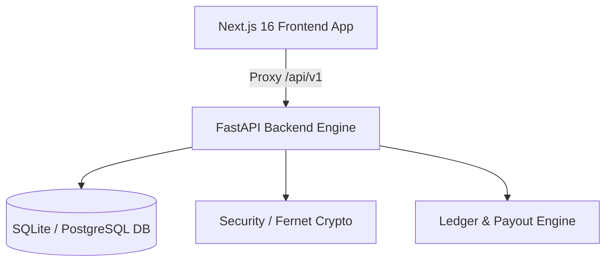

# 🧺 CampusLaundry — Peer-to-Peer Laundry Delivery System

> Built for **SRM University AP** campus hostel residents and student delivery partners.

---

## 🚀 Overview

**CampusLaundry** solves the daily hostel chore of walking to the campus laundry counter. Students can book doorstep dirty bag drops or fresh clean laundry pickups, while approved fellow campus students earn flexible per-trip income delivering bags between hostel blocks and the central laundry desk.

---

## 🌟 Key Features

### 🎓 For Students
- **Dual Role Flow**: Dedicated portal for hostel residents.
- **Simplified Booking**: No manual counting of clothes required — just Room Number, Hostel Block, Student Name, Phone Number, and Laundry Portal Slip Screenshot.
- **10 Campus Hostel Blocks**: Full support for Ganga A, Ganga B, Vedavathi, Yamuna, Narmada, Saraswati, Kaveri, Krishna, Godavari, and Teestha.
- **Handoff Security Code**: 4-digit verification code to ensure secure bag exchanges at the room door.
- **Real-Time Order Tracking**: 3-second live polling with status timeline, partner contact details (Name & Phone), and direct Call/WhatsApp action buttons.
- **Instant In-App Notifications**: Alerts when a delivery partner accepts the order.

### 🛵 For Delivery Partners
- **18+ Verification & Terms**: Delivery partners must confirm they are 18+ and accept legal terms to log in and accept jobs.
- **Live Open Requests Pool**: Real-time broadcasts of available campus hostel pickup and drop jobs with transparent earnings (`₹15 - ₹35` per trip).
- **One-Tap Acceptance**: Immediate assignment with student room, name, and phone number for seamless communication.
- **Earnings Wallet**: Live tracking of available and pending balances with instant UPI withdrawals (`@okaxis`, `@upi`).

---

## 🏗️ Architecture & Tech Stack



- **Frontend**: Next.js 16 (App Router, Turbopack, React 19, Vanilla CSS Design Tokens, Lucide Icons).
- **Backend**: FastAPI (Python 3.14 / 3.11), SQLAlchemy 2.0 (Async), Pydantic v2, Uvicorn.
- **Authentication**: Passwordless University Email OTP (`@srmap.edu.in`) with JWT access & refresh tokens.
- **Database**: SQLite (Async with `aiosqlite`) / PostgreSQL compatible.
- **Security**: Fernet encryption for handoff codes, argon2id password hashing, CSRF headers, rate limiting.

---

## 🏃 Getting Started

### 1. Backend Setup
```bash
cd backend
python -m venv .venv
source .venv/bin/activate
pip install -r requirements.txt
uvicorn app.main:app --host 127.0.0.1 --port 8000 --reload
```
API documentation available at `http://127.0.0.1:8000/docs` in dev mode.

### 2. Frontend Setup
```bash
cd frontend
npm install
npm run dev
```
Open `http://localhost:3000` to access the application.

### 3. Demo Credentials
- **Student**: `student@srmap.edu.in` (Sandbox OTP: `123456`)
- **Delivery Partner (18+)**: `partner@srmap.edu.in` (Sandbox OTP: `123456`)

---

## 📄 License
MIT License. Built for university campus delivery operations.
